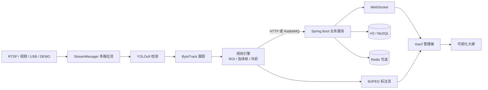

# 基于 YOLO 的工地安全行为实时检测预警系统

面向建筑工地场景的「视频接入 → YOLO 实时检测 → 规则判定 → 秒级告警 → 处置闭环 → 统计分析」全链路系统。
算法服务（Python / YOLOv8 / FastAPI）与业务服务（Spring Boot 3 / Vue 3）物理分离，
既能在没有 GPU、没有 Docker 的笔记本上完整演示，也能通过 Docker Compose 切换到 MySQL + Redis + RabbitMQ 的生产形态。


## 功能特性

- **多源视频接入**：RTSP 摄像头、本地视频文件、USB 摄像头、DEMO 合成流
- **实时检测**：安全帽佩戴 / 未佩戴、反光衣穿着 / 未穿着、人员，画面叠加检测框
- **多目标跟踪**：ByteTrack 分配 trackId，同一目标不重复告警
- **区域规则**：画面上绘制多边形 ROI，支持危险区域入侵判定
- **告警引擎**：置信度 + 连续 N 帧 + 冷却时间 + ROI 四重过滤
- **实时推送**：WebSocket 秒级推送，前端弹窗 + 声音 + 列表刷新
- **处置闭环**：待处理 / 已确认 / 已整改 / 误报，记录处置人与备注
- **统计报表**：趋势、行为排行、状态分布、Excel 导出
- **可视化大屏**：1920×1080 自适应，30 秒自动刷新
- **权限管理**：JWT + ADMIN / MANAGER / INSPECTOR 三角色
- **操作审计**：非查询类接口自动记录操作日志
- **可插拔中间件**：默认 H2 + HTTP 直投；`redis` / `mq` Profile 切换 Redis 与 RabbitMQ

## 界面预览

| 实时监控（DEMO） | 实时监控（真实 YOLO） |
| --- | --- |
|  |  |

| 区域配置 | 可视化大屏 |
| --- | --- |
|  |  |

## 系统架构



- **算法服务**：每 20 秒从后端拉取摄像头 / 区域 / 规则，自动启停工作线程；按抽帧策略推理，命中规则后保存截图并上报事件。
- **业务服务**：幂等落库、WebSocket 广播、统计聚合、权限与审计。
- **前端**：监控页直接消费算法服务的 MJPEG 标注流，检测框与画面天然对齐；告警通过 WebSocket 实时到达。

详细设计见 [系统设计说明](docs/02-系统设计.md)。

## 技术栈

| 层次 | 技术 |
| --- | --- |
| 算法 | Python 3.12、PyTorch、Ultralytics YOLOv8、OpenCV、ByteTrack、FastAPI |
| 后端 | Java 21、Spring Boot 3.2、MyBatis-Plus、Spring Security + JWT、WebSocket、Redis（可选）、RabbitMQ（可选） |
| 前端 | Vue 3、Vite、TypeScript、Pinia、Vue Router、Element Plus、ECharts |
| 数据库 | H2（默认，零依赖）/ MySQL 8（生产） |
| 部署 | Docker Compose、Nginx |

## 目录结构

```text
yuanyu/
├── ai-service/          Python 算法服务
│   ├── app/             FastAPI、检测、跟踪、规则、拉流、MQ
│   ├── scripts/         数据准备 / 训练 / 评估脚本
│   ├── weights/         模型权重（best.pt 不入库）
│   └── snapshots/       告警截图
├── backend/             Spring Boot 业务服务
│   └── src/main/java/com/yuanyu/safety/
├── frontend/            Vue3 管理端 + 大屏
├── deploy/              docker-compose、MySQL 初始化脚本
├── docs/                设计文档、接口文档、测试记录、截图
└── README.md
```

## 快速启动

### 环境要求

| 依赖 | 版本 | 说明 |
| --- | --- | --- |
| JDK | 17+ | 本项目在 Java 21 验证 |
| Maven | 3.8+ | |
| Node.js | 18+ | 本项目在 Node 24 验证 |
| Python | 3.10–3.12 | 推荐 3.12 |
| 可选 | Docker | 仅生产部署需要 |

> 默认使用 H2 文件数据库与 HTTP 事件直投，**不需要安装 MySQL、Redis、RabbitMQ**。

### 1. 启动后端（端口 8080）

```bash
cd backend
mvn spring-boot:run
```

首次启动会自动建表并写入演示数据（账号、工地、摄像头、规则、近 7 天告警）。

验证：

```bash
curl http://127.0.0.1:8080/api/health
```

### 2. 启动算法服务（端口 8000）

```bash
cd ai-service
./run.sh
```

首次运行会创建 `.venv` 并安装核心依赖。默认是 **DEMO 模式**：没有模型权重也能生成合成画面、检测框与真实告警，用于完整演示业务链路。

验证：

```bash
curl http://127.0.0.1:8000/ai/health
```

### 3. 启动前端（端口 5173）

```bash
cd frontend
npm install
npm run dev
```

浏览器访问 <http://localhost:5173>。

### 演示账号

| 账号 | 密码 | 角色 | 权限 |
| --- | --- | --- | --- |
| admin | 123456 | 系统管理员 | 全部 |
| manager | 123456 | 项目经理 | 工地、摄像头、区域、告警 |
| inspector | 123456 | 安全员 | 监控、告警处置、统计 |

## 检测模式

### DEMO 模式（默认，开箱即用）

- 无需权重、无需摄像头，算法服务合成工地画面与检测结果
- 用于验证「拉流 → 检测 → 规则 → 告警 → 推送 → 处置」全链路
- 画面左上角标注 `DEMO SOURCE`，HUD 显示 `MOCK`

### YOLO 模式（真实模型）

仓库已经带了两个权重：

| 权重 | 用途 |
| --- | --- |
| `ai-service/weights/ppe_best.pt` | 第三方 PPE 模型，检测 hardhat / no-hardhat / safety vest / no-safety vest |
| `ai-service/weights/yolov8n.pt` | COCO 人物检测，专用于人数统计与危险区域入侵判定 |

1. 安装训练/推理依赖：

   ```bash
   cd ai-service
   source .venv/bin/activate
   pip install -r requirements-yolo.txt
   ```

2. 以真实模型启动（Apple Silicon 用 `mps`，NVIDIA 用 `cuda`，无 GPU 用 `cpu`）：

   ```bash
   MODEL_PATH=weights/ppe_best.pt DETECTOR_MODE=yolo DEVICE=mps ./run.sh
   ```

3. 在「摄像头管理」中启用 **AI 实景演示**（内置 `videos/demo_site.mp4`），
   或新增自己的 RTSP / 视频源；「实时监控」选择该摄像头即可看到真实检测框。

4. 访问 <http://127.0.0.1:8000/ai/health>，确认 `"mode": "yolo"` 且 `"personModel": true`。

> **双模型设计**：PPE 数据集的 `person` 标注往往不完整，单独使用会导致危险区域入侵漏检。
> 因此算法服务同时加载 COCO `yolov8n` 只检测 person，PPE 模型负责安全帽/反光衣，两者结果合并。
>
> **注意**：`ppe_best.pt` 为第三方开源基线，类别与场景有限（无 GPU 时约 10 FPS），
> 正式答辩建议用自己的数据集重新训练，并在论文中报告 mAP、P、R、F1 与 FPS。
>
> DEMO 类型摄像头始终使用合成检测结果，即使切换到 YOLO 模式也不会浪费算力。

### 训练自己的模型

```bash
cd ai-service
source .venv/bin/activate
pip install -r requirements-yolo.txt

# 1) 整理数据（YOLO 格式），生成 data.yaml
python scripts/prepare_dataset.py --source /path/to/raw --output datasets/safety \
  --classes person helmet no_helmet vest no_vest

# 2) 训练（Apple Silicon 自动使用 MPS，NVIDIA 用 --device 0）
python scripts/train.py --data datasets/safety/data.yaml --model yolov8n.pt \
  --epochs 100 --imgsz 640 --batch 16

# 3) 评估，输出 mAP / P / R / F1 / FPS
python scripts/evaluate.py --weights weights/safety.pt --data datasets/safety/data.yaml
```

训练完成后 `best.pt` 会自动复制到 `weights/safety.pt`。数据来源建议：

- SHWD 安全帽数据集（约 7.5k 张，person / helmet 两类）
- Roboflow Construction Site Safety（含反光衣、person 等类别）
- 自建数据：现场拍摄 + Label Studio / labelImg 标注

## 页面说明

| 路由 | 页面 | 说明 |
| --- | --- | --- |
| `/login` | 登录 | 三角色演示账号 |
| `/` | 安全驾驶舱 | 核心指标、趋势、行为排行、最新告警 |
| `/monitor` | 实时监控 | 多路切换、MJPEG 标注流、实时指标、告警侧栏 |
| `/alarms` | 告警中心 | 多条件筛选、详情、截图、处置、Excel 导出 |
| `/sites` | 工地管理 | 工地 CRUD |
| `/cameras` | 摄像头管理 | 四类视频源、连通性测试、启停 |
| `/areas` | 区域配置 | Canvas 多边形绘制，百分比坐标保存 |
| `/rules` | 告警规则 | 阈值、连续帧、冷却、级别、生效时段 |
| `/statistics` | 统计分析 | 趋势、分布、行为明细 |
| `/users` | 用户管理 | 账号、角色、状态 |
| `/logs` | 操作日志 | 非查询操作审计 |
| `/screen` | 可视化大屏 | 1920×1080，30 秒刷新 |

## 主要配置

后端 `backend/src/main/resources/application.yml`：

| 配置 | 默认值 | 说明 |
| --- | --- | --- |
| `server.port` | 8080 | 后端端口 |
| `app.jwt.secret` | 内置开发密钥 | 生产必须通过 `JWT_SECRET` 覆盖 |
| `app.internal-token` | `yuanyu-internal-2026` | 算法服务内部调用凭证 |
| `app.ai-base-url` | `http://127.0.0.1:8000` | 算法服务地址 |
| `app.cors-origins` | `http://localhost:5173,...` | 开发跨域白名单 |

算法服务环境变量（`ai-service/.env.example`）：

| 变量 | 默认值 | 说明 |
| --- | --- | --- |
| `BACKEND_BASE_URL` | `http://127.0.0.1:8080` | 后端地址 |
| `INTERNAL_TOKEN` | `yuanyu-internal-2026` | 与后端一致 |
| `MODEL_PATH` | `weights/safety.pt` | PPE 权重路径 |
| `PERSON_MODEL_PATH` | `weights/yolov8n.pt` | COCO 人物检测权重 |
| `PERSON_CONF` | 0.35 | 人物检测置信度 |
| `DETECTOR_MODE` | `auto` | `auto` / `yolo` / `mock` |
| `DEVICE` | `auto` | `auto` / `mps` / `cuda` / `cpu` |
| `MAX_WIDTH` | 960 | 处理分辨率 |
| `TARGET_FPS` | 16 | DEMO 输出帧率 |
| `INFER_EVERY` | 2 | 每 N 帧推理一次 |
| `PUBLISH_MODE` | `http` | `http` 或 `rabbit` |

## 生产部署（Docker Compose）

```bash
cd deploy
docker compose up -d --build
```

启动 MySQL、Redis、RabbitMQ、后端、算法服务、Nginx 六个容器，访问 <http://localhost>。
Nginx 负责静态资源、`/api`、`/ai`（MJPEG 关闭缓冲）与 `/ws` 升级代理。

详见 [部署说明](deploy/README.md)。

## 测试与验证

```bash
# 后端单元/接口测试
cd backend && mvn test

# 前端生产构建
cd frontend && npm run build

# 算法服务语法与导入检查
cd ai-service && ./.venv/bin/python -c "import app.main"
```

已验证：

- `mvn test`：8 个用例全部通过（含地址脱敏与鉴权）
- `npm run build`：构建成功
- 端到端：DEMO 流 → YOLO 规则 → 告警落库 → WebSocket 推送 → 前端弹窗
- 截图与详细记录见 [测试记录](docs/04-测试与验收.md)

## 常见问题

**Q：监控页一直转圈 / 显示“画面加载中”？**
确认算法服务已启动（`curl :8000/ai/health`），且摄像头已启用。算法服务每 20 秒同步一次配置，新增摄像头后稍等片刻。

**Q：告警没有实时弹窗？**
检查浏览器控制台 WebSocket 是否连接成功；后端重启后前端会自动重连。确认 `INTERNAL_TOKEN` 前后端一致。

**Q：如何切换 MySQL？**
建库并导入 `deploy/sql/init.sql`，然后：

```bash
cd backend
SPRING_PROFILES_ACTIVE=mysql \
MYSQL_HOST=127.0.0.1 MYSQL_USER=root MYSQL_PASSWORD=你的密码 \
mvn spring-boot:run
```

**Q：H2 数据库被占用？**
关闭其他后端进程，或删除 `backend/data/yuanyu.lock.db`（不要删 `.mv.db`）。

**Q：端口被占用？**
后端 `SERVER_PORT=8081`，算法服务 `PORT=8001`，前端在 `vite.config.ts` 中调整代理目标。

**Q：没有 GPU 可以跑吗？**
可以。DEMO 模式为纯 CPU；YOLO 模式在 Apple Silicon 使用 MPS，其他机器自动回退 CPU。CPU 下建议 `INFER_EVERY=3`、`MAX_WIDTH=640`。

## 隐私与脱敏

| 项目 | 处理方式 |
| --- | --- |
| 工地地址 | 列表/浏览态保留到区县，街道门牌替换为 `****`；编辑详情仅 ADMIN/MANAGER 可读取完整地址 |
| 账号密码 | BCrypt 加盐哈希；接口响应通过 `WRITE_ONLY` 隐藏 |
| 操作日志 | 只记录模块、操作、IP、耗时，不记录请求参数，避免密码/手机号落库 |
| 演示数据 | 工地、人员、电话、地址均为虚构（示例市/示例区/示例路） |
| 视频与截图 | 当前未做人脸模糊；生产环境建议开启或替换为脱敏素材 |
| `/ai` 资源 | 开发环境开放，生产环境应加签名 URL 或 Nginx 鉴权 |

可通过 `MASK_SITE_LOCATION=false` 关闭地址脱敏（仅建议内网调试使用）。

## 已知限制

- 工地地址仅做展示层脱敏，数据库仍保存完整地址；如需存储层脱敏，应在入库前加密/截断
- DEMO 模式为合成画面，仅用于链路演示，不代表真实算法精度
- 内置 `ppe_best.pt` 为第三方基线模型，安全帽/反光衣在部分场景存在误判，需用自己的数据微调
- 浏览器摄像头（WebRTC 推流）尚未接入，当前支持 RTSP / 文件 / USB / DEMO
- 模型管理页仅提供列表接口，热切换需重启算法服务
- 未实现跨摄像头 ReID、人脸识别、BIM 数字孪生

## 文档

- [提示词优化稿](docs/01-提示词优化.md)
- [系统设计说明](docs/02-系统设计.md)
- [接口文档](docs/03-接口文档.md)
- [测试与验收](docs/04-测试与验收.md)
- [算法服务说明](ai-service/README.md)
- [部署说明](deploy/README.md)
- [上传到 GitHub](docs/05-GitHub上传.md)

## 致谢

- [Ultralytics YOLOv8](https://github.com/ultralytics/ultralytics)
- [ByteTrack](https://github.com/ifzhang/ByteTrack)
- PPE 预训练权重：[baskarmother/yolov8-ppe-construction](https://huggingface.co/baskarmother/yolov8-ppe-construction)（MIT）
- 数据集参考：SHWD、Roboflow Construction Site Safety

## 许可

- 本项目原创代码：MIT
- YOLOv8 / Ultralytics：AGPL-3.0
- `ppe_best.pt`：MIT（来自 HuggingFace 开源模型）
- 演示视频素材来自 SHWD 公开数据集示例图，仅用于教学演示；公开传播前请替换为自有素材

本项目仅用于学习与毕业设计演示，请勿直接用于真实工地的安全生产决策。
