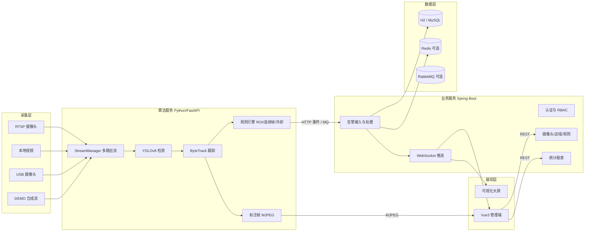
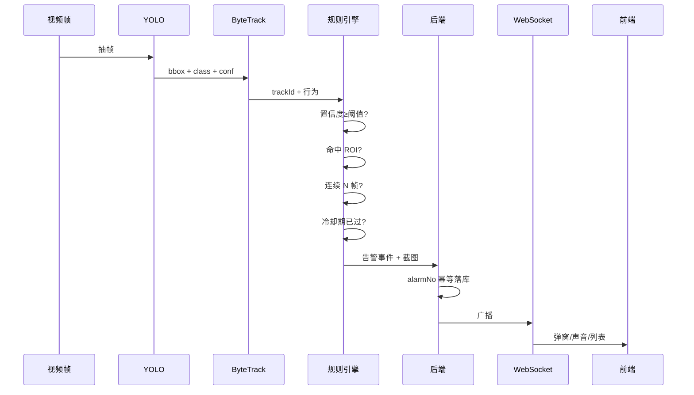

# 系统设计说明（v1.0）

> 项目：基于 YOLO 的工地安全行为实时检测预警系统
> 形态：Spring Boot 业务后端 + Python 算法服务 + Vue3 管理端
> 原则：本地零依赖可跑（H2 + 内置事件通道），生产可切换 MySQL/Redis/RabbitMQ

## 0. 实现状态（v1.0）

| 模块 | 状态 | 说明 |
| --- | --- | --- |
| 认证与 RBAC | 已实现 | JWT + 三角色，方法级鉴权 |
| 工地/摄像头/区域/规则 | 已实现 | 完整 CRUD，ROI 百分比坐标 |
| 实时检测 | 已实现 | DEMO 合成源 + YOLOv8 双模型（PPE + COCO person） |
| 跟踪与规则 | 已实现 | ByteTrack + 连续帧 + 冷却 + ROI |
| 告警链路 | 已实现 | HTTP 默认，`mq` Profile 走 RabbitMQ |
| WebSocket 推送 | 已实现 | 原生 WebSocket + JWT 握手 |
| 告警处置/导出 | 已实现 | 状态流转、POI Excel |
| 统计与大屏 | 已实现 | ECharts、30 秒刷新 |
| 操作审计 | 已实现 | AOP 记录非查询接口 |
| 地址脱敏 | 已实现 | 列表脱敏、编辑详情鉴权、`MASK_SITE_LOCATION` 开关 |
| Redis | 可选 | `redis` Profile 启用 Token 黑名单 |
| 模型管理 | 部分实现 | 列表接口；热切换需重启算法服务 |
| 小程序/浏览器摄像头 | 未实现 | 列为后续扩展 |

与最初设计相比：统计表改为实时聚合（数据量小，避免额外一致性成本），`sys_notify_record` 暂未落地，表数量为 10 张。

---

## 1. 运行形态与降级策略

| 组件 | 开发默认（本机） | 生产/容器（profile） |
|------|------------------|----------------------|
| 数据库 | H2 文件库 `./data/yuanyu` | MySQL 8（`mysql`） |
| 缓存/Token 黑名单 | 进程内 Map | Redis（`redis`） |
| 事件通道 | 算法服务 HTTP 直投 | RabbitMQ（`mq`） |
| 对象存储 | 本地 `snapshots/` | MinIO（预留） |
| 算法 | 有 `weights/safety.pt` 用 YOLO，否则 mock 演示模式 | 同左 + ONNX/TensorRT |

设计要点：**所有可选中间件都通过接口抽象 + Profile 切换**，缺省路径不依赖 Docker，保证答辩现场一定能跑。

---

## 2. 总体架构



### 2.1 数据流

1. 算法服务每 20 秒从后端 `GET /api/internal/config` 拉取启用的摄像头、ROI、规则，自动启停工作线程。
2. 每路视频独立线程拉流解码，按 `infer_every_n` 抽帧推理，ByteTrack 维持 trackId。
3. 规则引擎对「目标 + 行为 + 区域 + 连续帧 + 冷却」做判定，命中则保存标注截图并生成事件。
4. 事件通过 HTTP（默认）或 RabbitMQ（`mq` profile）投递到后端。
5. 后端幂等落库、写入检测记录、通过 WebSocket 广播，前端弹窗 + 声音 + 列表刷新。
6. 前端监控页直接消费算法服务的 MJPEG 标注流，画面与检测框天然对齐。

### 2.2 告警判定流程



---

## 3. 模块划分

| 模块 | 职责 | 关键类 |
|------|------|--------|
| 认证 | 登录、JWT、角色鉴权 | `AuthController`、`JwtFilter`、`SecurityConfig` |
| 基础数据 | 工地、摄像头、区域、规则 | `CameraService`、`AreaService`、`RuleService` |
| 告警 | 接入、查询、处置、导出 | `AlarmIngestService`、`AlarmController` |
| 实时 | WebSocket 会话管理与广播 | `AlarmWebSocketHandler` |
| 统计 | 总览、趋势、排行 | `DashboardController` |
| 算法 | 拉流、推理、跟踪、规则、MJPEG | `StreamManager`、`Detector`、`RuleEngine` |
| 前端 | 登录、监控、告警、配置、统计、大屏 | `views/*`、`stores/*` |

---

## 4. 数据库设计

共 10 张表：2 张权限表 + 7 张业务表 + 1 张日志表。

### 4.1 sys_role

| 字段 | 类型 | 说明 |
|------|------|------|
| id | BIGINT PK | 自增 |
| role_code | VARCHAR(30) UK | ADMIN / MANAGER / INSPECTOR |
| role_name | VARCHAR(50) | 管理员 / 项目经理 / 安全员 |
| description | VARCHAR(200) | 说明 |

### 4.2 sys_user

| 字段 | 类型 | 说明 |
|------|------|------|
| id | BIGINT PK | |
| username | VARCHAR(50) UK | 登录名 |
| password | VARCHAR(100) | BCrypt |
| real_name | VARCHAR(50) | 姓名 |
| phone | VARCHAR(20) | 手机号 |
| role_code | VARCHAR(30) | 关联角色 |
| status | TINYINT | 1 启用 0 禁用 |
| create_time / update_time | DATETIME | 审计 |
| deleted | TINYINT | 逻辑删除 |

### 4.3 biz_site

| 字段 | 类型 | 说明 |
|------|------|------|
| id | BIGINT PK | |
| site_name | VARCHAR(100) | 工地名称 |
| address | VARCHAR(200) | 地址 |
| manager | VARCHAR(50) | 负责人 |
| phone | VARCHAR(20) | 联系电话 |
| status | TINYINT | 1 在建 0 停工 |
| create_time / update_time / deleted | | 审计 |

### 4.4 biz_camera

| 字段 | 类型 | 说明 |
|------|------|------|
| id | BIGINT PK | |
| site_id | BIGINT | 所属工地 |
| camera_name | VARCHAR(100) | 摄像头名称 |
| stream_url | VARCHAR(500) | RTSP/文件路径/设备编号 |
| stream_type | VARCHAR(20) | RTSP / VIDEO / USB / DEMO |
| location | VARCHAR(100) | 安装位置 |
| enabled | TINYINT | 是否启用 |
| last_heartbeat | DATETIME | 算法服务上报心跳 |
| create_time / update_time / deleted | | 审计 |

### 4.5 biz_area

| 字段 | 类型 | 说明 |
|------|------|------|
| id | BIGINT PK | |
| camera_id | BIGINT | 所属摄像头 |
| area_name | VARCHAR(100) | 区域名称 |
| area_type | VARCHAR(20) | DANGER / SAFE |
| points | TEXT | 百分比坐标 JSON `[[0.1,0.2],...]` |
| enabled | TINYINT | 是否启用 |

### 4.6 biz_rule

| 字段 | 类型 | 说明 |
|------|------|------|
| id | BIGINT PK | |
| rule_name | VARCHAR(100) | 规则名称 |
| behavior_type | VARCHAR(30) | NO_HELMET / NO_VEST / INTRUSION |
| camera_id | BIGINT NULL | 为空表示全局 |
| min_confidence | DECIMAL(4,3) | 置信度阈值 |
| consecutive_frames | INT | 连续帧确认 |
| cooldown_seconds | INT | 冷却时间 |
| level | VARCHAR(10) | LOW / MEDIUM / HIGH |
| start_time / end_time | VARCHAR(5) | 生效时段 HH:mm，空为全天 |
| enabled | TINYINT | |

### 4.7 biz_alarm

| 字段 | 类型 | 说明 |
|------|------|------|
| id | BIGINT PK | |
| alarm_no | VARCHAR(40) UK | 幂等键 |
| camera_id / camera_name | BIGINT / VARCHAR | 冗余名称便于查询 |
| site_id | BIGINT | |
| behavior_type | VARCHAR(30) | |
| level | VARCHAR(10) | |
| confidence | DECIMAL(4,3) | |
| track_id | INT | 跟踪 ID |
| bbox | VARCHAR(100) | `x1,y1,x2,y2` 百分比 |
| snapshot_url | VARCHAR(255) | 截图地址 |
| alarm_time | DATETIME | 告警时间 |
| status | VARCHAR(20) | PENDING / CONFIRMED / REPAIRED / FALSE_ALARM |
| handler_id / handler_name | BIGINT / VARCHAR | 处置人 |
| handle_time | DATETIME | |
| handle_remark | VARCHAR(500) | |
| create_time | DATETIME | |

索引：`idx_alarm_time`、`idx_camera_status`、`idx_behavior`。

### 4.8 biz_detection_record

| 字段 | 类型 | 说明 |
|------|------|------|
| id | BIGINT PK | |
| camera_id | BIGINT | |
| record_time | DATETIME | |
| person_count / helmet_count / no_helmet_count / vest_count / no_vest_count | INT | 当帧统计 |
| fps / inference_ms | DECIMAL(6,2) | 性能 |
| model_version | VARCHAR(50) | |

### 4.9 biz_model

| 字段 | 类型 | 说明 |
|------|------|------|
| id | BIGINT PK | |
| model_name / version | VARCHAR | |
| file_path | VARCHAR(255) | |
| map50 / precision / recall | DECIMAL(6,4) | 指标 |
| status | VARCHAR(20) | ACTIVE / INACTIVE |
| deploy_time / create_time | DATETIME | |

### 4.10 sys_operation_log

| 字段 | 类型 | 说明 |
|------|------|------|
| id | BIGINT PK | |
| user_id / username | BIGINT / VARCHAR | |
| module / operation | VARCHAR | |
| method / params | VARCHAR(1000) | |
| ip | VARCHAR(50) | |
| cost_ms | BIGINT | |
| create_time | DATETIME | |

---

## 5. 接口契约

统一返回体：

```json
{ "code": 0, "message": "success", "data": {} }
```

错误码：`0` 成功、`400` 参数错误、`401` 未登录、`403` 无权限、`404` 不存在、`500` 服务异常。

### 5.1 认证

| 方法 | 路径 | 入参 | 出参 |
|------|------|------|------|
| POST | /api/auth/login | `{username,password}` | `{token,user}` |
| GET | /api/auth/me | - | `user` |
| POST | /api/auth/logout | - | - |

### 5.2 业务

| 方法 | 路径 | 说明 |
|------|------|------|
| GET/POST/PUT/DELETE | /api/sites | 工地 |
| GET/POST/PUT/DELETE | /api/cameras | 摄像头 |
| POST | /api/cameras/{id}/test | 连通性测试 |
| GET/POST/PUT/DELETE | /api/areas | 区域 |
| GET/POST/PUT/DELETE | /api/rules | 规则 |
| GET | /api/alarms | 分页查询 |
| GET | /api/alarms/{id} | 详情 |
| PUT | /api/alarms/{id}/handle | 处置 |
| GET | /api/alarms/export | Excel |
| GET | /api/dashboard/summary | 总览 |
| GET | /api/dashboard/trend | 趋势 |
| GET | /api/dashboard/ranking | 排行 |
| GET | /api/users | 用户（ADMIN） |
| GET | /api/detections/latest | 最新检测指标 |
| GET | /api/health | 健康检查（公开） |

### 5.3 内部接口（算法服务调用）

| 方法 | 路径 | 说明 |
|------|------|------|
| GET | /api/internal/config | 摄像头 + 区域 + 规则 |
| POST | /api/internal/alarms | 告警事件（`X-Internal-Token`） |
| POST | /api/internal/detections | 检测指标 |
| POST | /api/internal/heartbeat | 摄像头心跳 |

### 5.4 WebSocket

- 地址：`/ws/alarms?token=<JWT>`
- 服务端 → 客户端：`{type:"ALARM", data:{...}}`
- 心跳：客户端每 25 秒发 `ping`，服务端回 `pong`

### 5.5 算法服务

| 方法 | 路径 | 说明 |
|------|------|------|
| GET | /ai/health | 模型/设备/模式 |
| GET | /ai/streams | 运行中的流 |
| POST | /ai/streams/sync | 手动同步配置 |
| GET | /ai/streams/{cameraId}/mjpeg | 标注视频流 |
| POST | /ai/detect | 单图检测（浏览器拍照） |
| GET | /ai/snapshots/{file} | 告警截图 |
| GET/PUT | /ai/models | 模型列表/切换 |

---

## 6. 告警规则细节

| 行为 | 判定 | 默认阈值 |
|------|------|---------|
| NO_HELMET | 类别 `no_helmet`，或 `person` 头部区域无 `helmet` | conf ≥ 0.45，连续 3 帧 |
| NO_VEST | 类别 `no_vest` | conf ≥ 0.45，连续 3 帧 |
| INTRUSION | `person` 框底边中点在 DANGER 多边形内 | conf ≥ 0.40，连续 2 帧 |

过滤链：`置信度 → ROI → 连续帧 → 冷却 → 幂等`。冷却默认 60 秒，按 `cameraId + trackId + behavior` 维度。

---

## 7. 前端页面

| 路由 | 页面 | 角色 |
|------|------|------|
| /login | 登录 | 公开 |
| / | 驾驶舱 | 全部 |
| /monitor | 实时监控（MJPEG + 告警侧栏） | 全部 |
| /alarms | 告警中心（筛选/详情/处置/导出） | 全部 |
| /cameras | 摄像头管理 | ADMIN/MANAGER |
| /areas | 区域配置（Canvas 多边形） | ADMIN/MANAGER |
| /rules | 规则管理 | ADMIN |
| /statistics | 统计分析 | 全部 |
| /users | 用户管理 | ADMIN |
| /screen | 可视化大屏 | 全部 |

---

## 8. 目录结构

```text
yuanyu/
├── docs/                    设计、提示词、接口、部署
├── ai-service/
│   ├── app/
│   │   ├── main.py
│   │   ├── config.py
│   │   ├── api/             routes.py
│   │   ├── services/        detector.py tracker.py rules.py stream.py backend.py
│   │   └── schemas.py
│   ├── scripts/             prepare_dataset.py train.py evaluate.py
│   ├── weights/             safety.pt（gitignore）
│   ├── snapshots/
│   ├── requirements.txt
│   └── run.sh
├── backend/
│   ├── src/main/java/com/yuanyu/safety/
│   │   ├── SafetyApplication.java
│   │   ├── common/          Result, BizException, GlobalExceptionHandler, PageResult
│   │   ├── config/          SecurityConfig, JwtFilter, WebSocketConfig, MybatisPlusConfig
│   │   ├── controller/
│   │   ├── service/
│   │   ├── mapper/
│   │   ├── entity/
│   │   ├── dto/
│   │   └── ws/
│   ├── src/main/resources/  application.yml, schema.sql, data.sql, mapper/*.xml
│   └── pom.xml
├── frontend/
│   ├── src/                 api/ components/ layout/ router/ stores/ views/ utils/
│   ├── vite.config.ts
│   └── package.json
├── deploy/                  docker-compose.yml, nginx.conf, sql/init.sql
└── README.md
```

---

## 9. 启动方式

```bash
# 1. 算法服务
cd ai-service
./run.sh            # 首次自动创建 .venv 并安装核心依赖

# 2. 后端（H2，无需 MySQL）
cd backend
mvn spring-boot:run

# 3. 前端
cd frontend
npm install
npm run dev
```

访问 `http://localhost:5173`，账号 `admin / 123456`。

---

## 10. 验收清单

- [ ] 登录、角色菜单隔离
- [ ] DEMO 摄像头出画面，叠加检测框
- [ ] 未戴安全帽触发告警，2 秒内弹窗
- [ ] 同一目标冷却期内不重复告警
- [ ] 告警详情含截图，可处置
- [ ] 统计图表与数据库一致，可导出 Excel
- [ ] ROI 可绘制并生效
- [ ] 后端 `mvn test` 通过、前端 `npm run build` 通过
