# 功能截图总览

> 截图环境：macOS + Chrome 1440×900（可视化大屏为 1920×1080）。
> 数据为演示数据，人员、工地、地址均为虚构；演示视频人脸已模糊。
> 所有页面均来自实际运行系统，不是设计稿。

## 1. 登录与角色

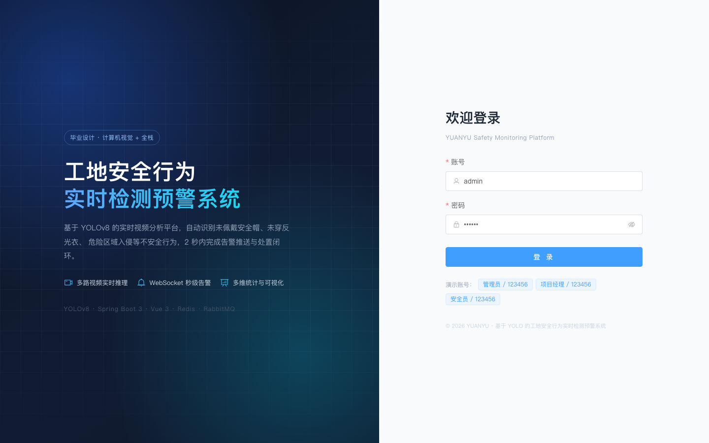

- 账号密码登录，JWT 无状态认证
- 内置 ADMIN / MANAGER / INSPECTOR 三种角色
- 登录页直接展示演示账号，方便答辩现场切换
- 登录失败、账号禁用、Token 过期均有统一提示

## 2. 安全驾驶舱

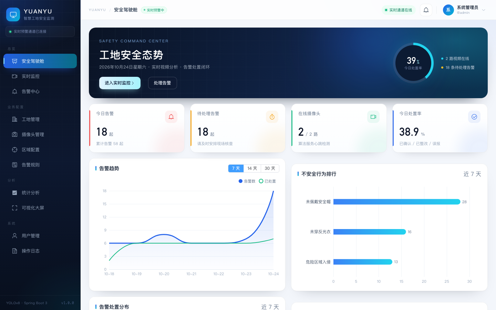

- 今日告警、待处理、在线摄像头、处置率四个核心指标
- 处置率环形仪表盘 + 实时视频/待处理状态
- 7/14/30 天告警趋势、行为排行、处置状态分布
- 最新告警列表，点击跳转告警详情
- WebSocket 实时推送，告警到达时弹窗 + 提示音

## 3. 实时监控

### 3.1 DEMO 合成视频源

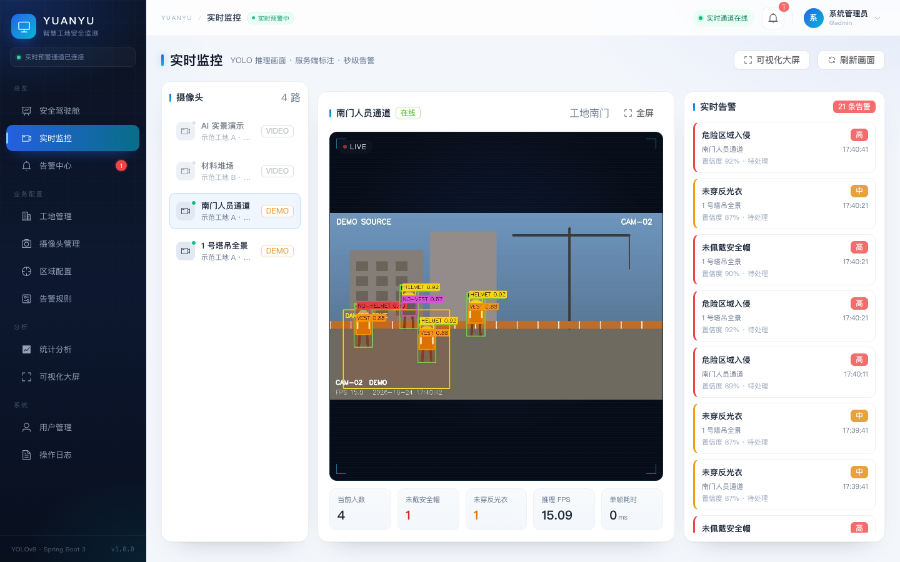

- 多路摄像头切换，在线/离线/停用状态
- 服务端绘制检测框后以 MJPEG 输出，画面与框天然对齐
- 当前人数、未戴安全帽、未穿反光衣、FPS、单帧耗时
- 右侧实时告警侧栏，按风险级别显示色条
- 支持全屏播放

### 3.2 真实 YOLO 模型

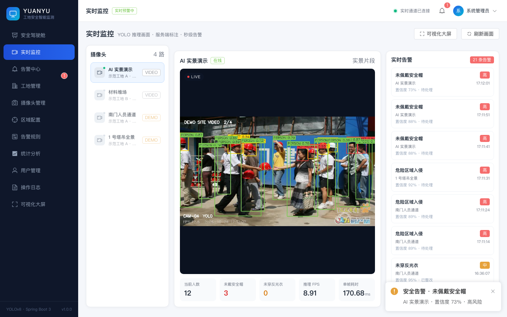

- `ppe_best.pt` + `yolov8n.pt` 双模型推理
- 真实工地视频源，检出 person / helmet / no_helmet 等目标
- Apple Silicon 使用 MPS，约 10–14 FPS
- 触发的告警带截图、置信度、trackId，实时进入告警中心

## 4. 告警中心

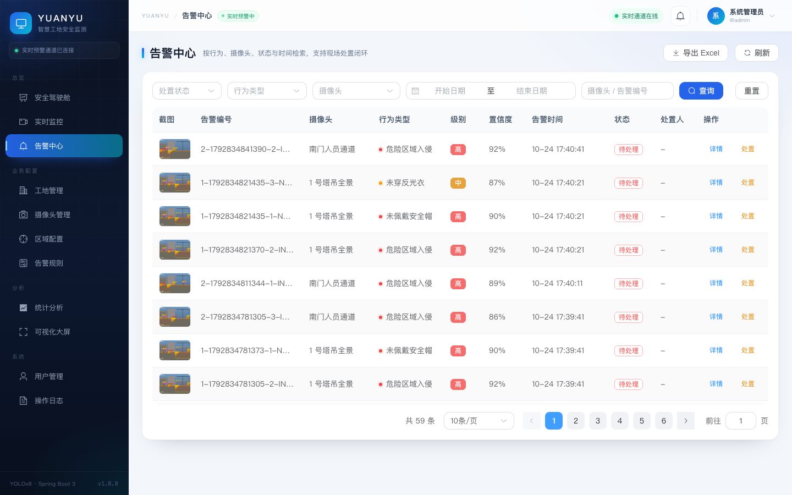

- 按状态、行为类型、摄像头、时间范围、关键字组合筛选
- 截图缩略图、告警编号、行为、级别、置信度、时间、处置人
- 分页、Excel 导出
- 风险级别用颜色圆点区分，支持快速定位

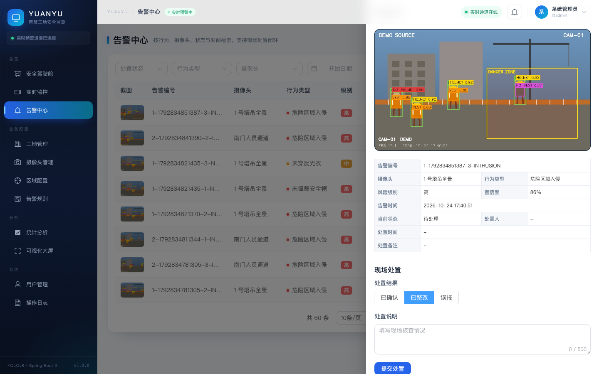

- 告警截图大图预览
- 告警编号、摄像头、行为、级别、置信度、时间、状态、处置人
- 现场处置：已确认 / 已整改 / 误报 + 处置说明
- 处置后状态实时同步到统计与 WebSocket 订阅端

## 5. 工地管理

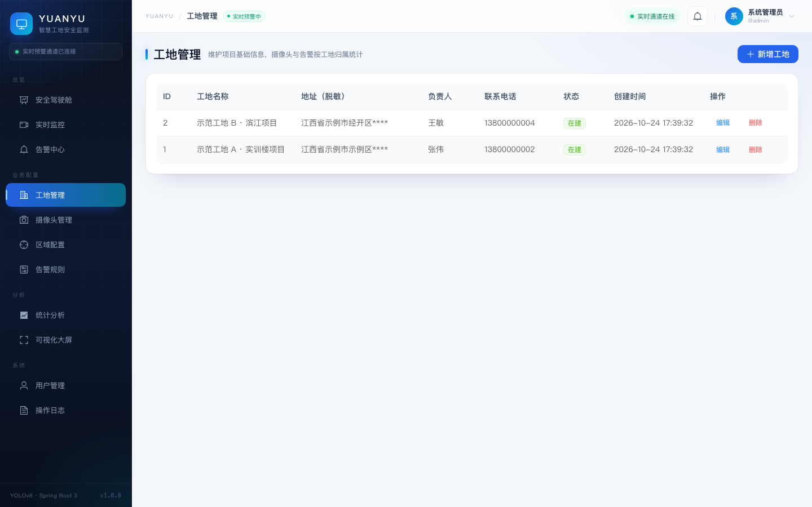

- 工地增删改查、负责人、联系电话、在建/停工状态
- **地址默认脱敏**：列表只显示到区县，街道门牌用 `****` 代替
- 编辑时通过详情接口获取完整地址，仅 ADMIN/MANAGER 可用
- 工地下存在摄像头时禁止删除

## 6. 摄像头管理

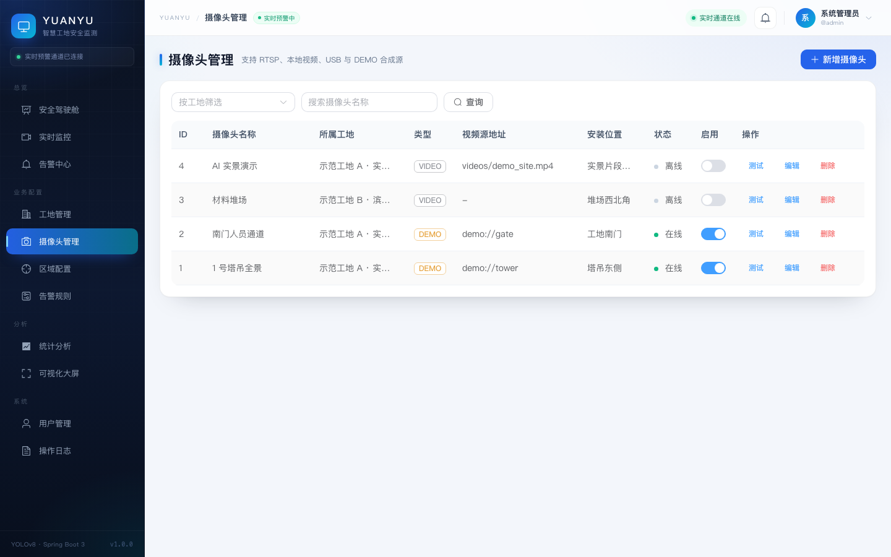

- 支持 RTSP / 本地视频 / USB / DEMO 四种视频源
- 所属工地、安装位置、在线状态、启用开关
- 连通性测试调用算法服务探测视频源
- 停用后算法服务自动停止对应线程

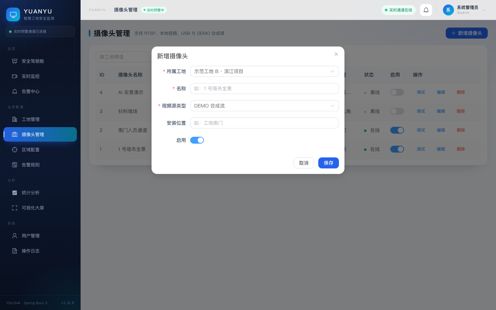

- 表单校验：非 DEMO 类型必须填写视频源地址
- 视频源类型切换时动态显示地址输入框
- 启用开关控制是否下发算法服务

## 7. 区域配置

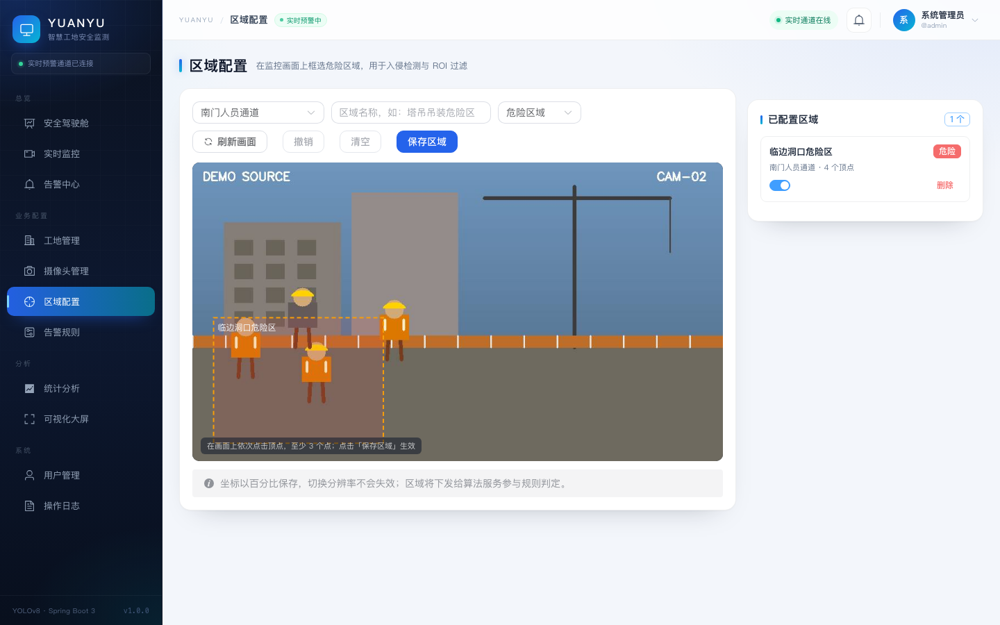

- 在监控画面上直接绘制多边形 ROI
- 坐标以百分比保存，切换分辨率不失效
- 支持撤销、清空、刷新画面、启用/停用
- 危险区域参与「区域入侵」规则判定
- 画面来自算法服务原始帧，不叠加检测框，便于框选

## 8. 告警规则

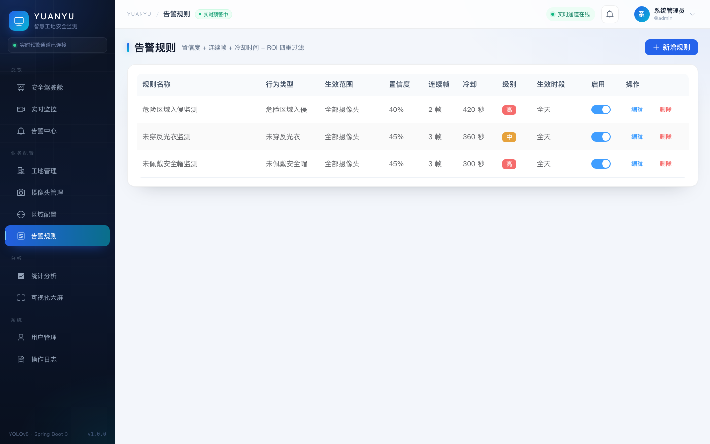

- 行为类型：未戴安全帽 / 未穿反光衣 / 危险区域入侵
- 全局规则或指定摄像头
- 置信度阈值、连续帧确认、冷却时间
- 告警级别、生效时段、启用开关
- 修改后算法服务 20 秒内自动同步

## 9. 统计分析

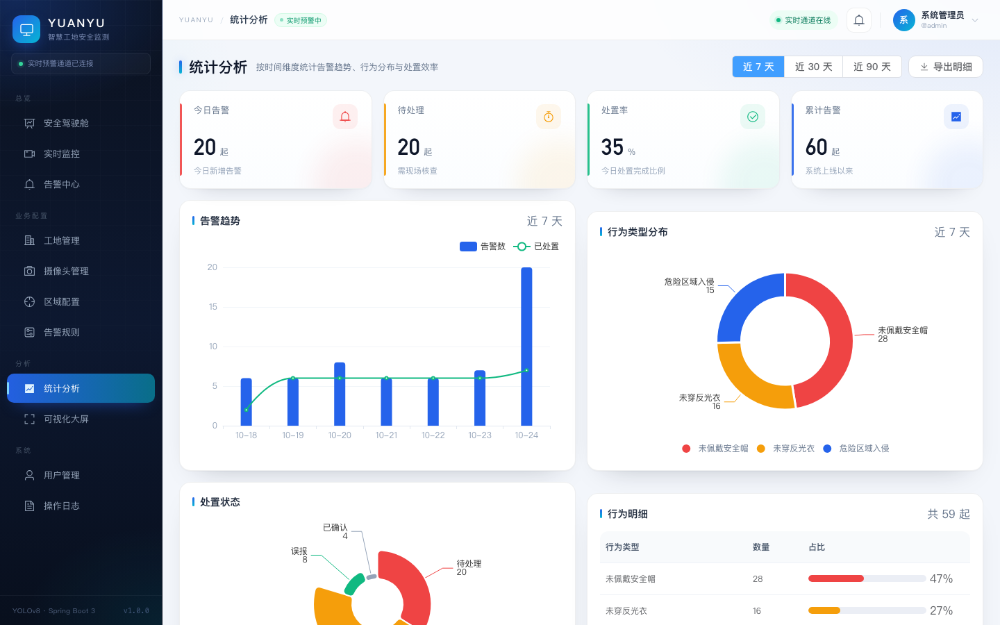

- 7/30/90 天切换
- 告警趋势柱线组合图、行为类型环形图
- 处置状态分布、行为明细与占比
- 一键导出告警 Excel

## 10. 用户管理

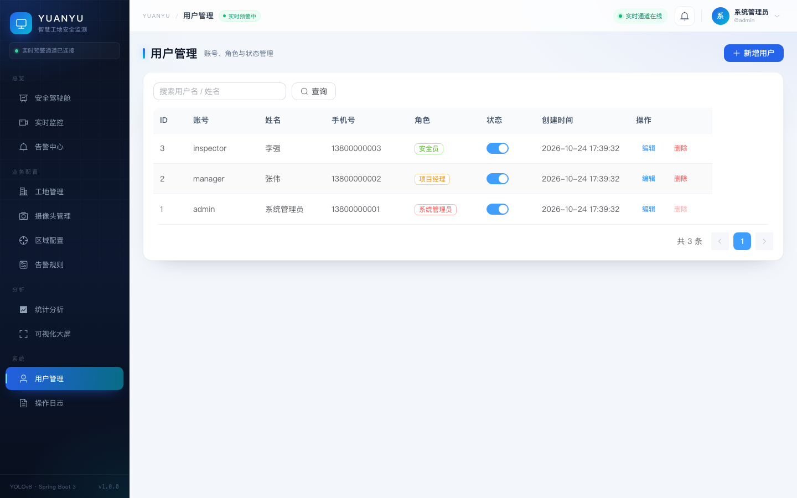

- 账号、姓名、手机号、角色、状态
- ADMIN / MANAGER / INSPECTOR 角色分配
- 新增、编辑、启用/停用、删除
- 密码 BCrypt 哈希，接口响应不回传密码

## 11. 操作日志

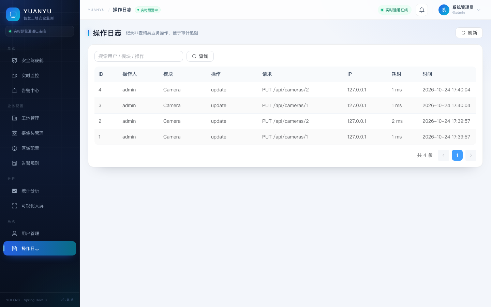

- AOP 自动记录非查询类业务操作
- 操作人、模块、操作、请求方法、IP、耗时、时间
- 不记录请求参数，避免密码等敏感信息落库
- 仅 ADMIN 可查看

## 12. 可视化大屏

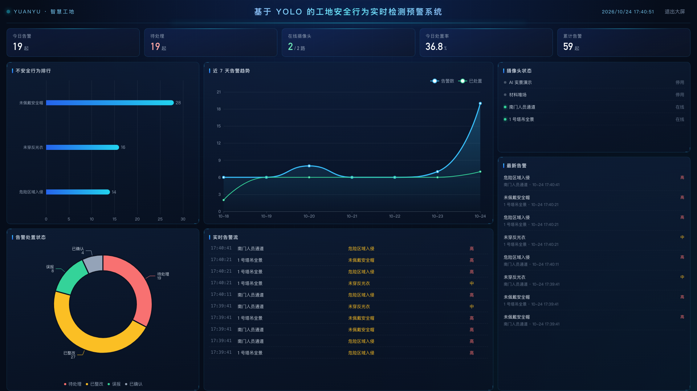

- 1920×1080 深色大屏，30 秒自动刷新
- 今日告警、待处理、在线摄像头、处置率、累计告警
- 行为排行、告警趋势、处置状态、摄像头状态、实时告警流
- 适合答辩投屏演示

## 13. 说明

- 截图中的工地、人员、地址均为虚构
- 演示视频素材已做人脸模糊
- 真实 YOLO 截图中部分检测框为模型误检，属于第三方基线模型的正常表现，正式使用需用自己的数据重新训练
